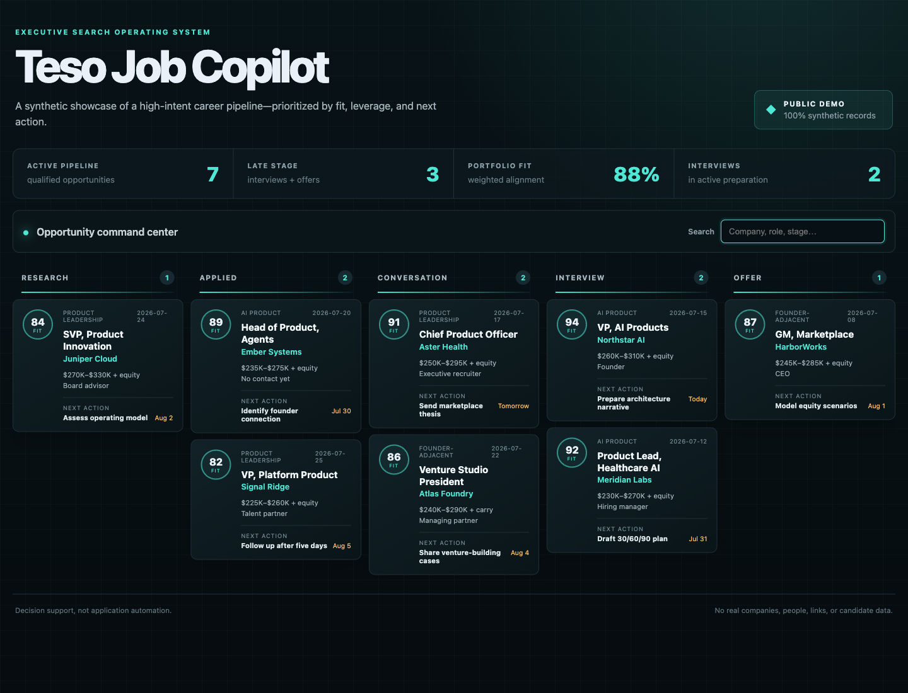
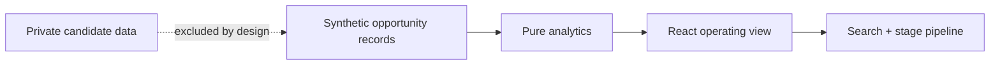

# Teso Job Copilot

[](https://github.com/ChrisTeso/teso-job-copilot/actions/workflows/ci.yml)
[](https://react.dev/)
[](SECURITY.md)

**An executive job-search operating system that turns a messy opportunity list into a prioritized, next-action pipeline.**

This recruiter-facing product slice demonstrates how I approach career operations as a product problem: qualify for fit, emphasize asymmetric upside, make the pipeline visible, and ensure every opportunity has a concrete next action.



## What it demonstrates

- a polished, responsive React and TypeScript command center;
- portfolio-level fit, late-stage, and activity metrics;
- stage-based operating views across research, applications, conversations, interviews, and offers;
- visible compensation, relationship, deadline, and next-action context;
- pure, tested filtering and aggregation functions;
- an explicit privacy projection separating a public showcase from candidate records.

Every company, role, contact role, date, compensation range, and workflow record is fictional. The app performs no network requests and includes no production job-search data.

## Run it

```bash
npm install
npm run dev
```

## Verify

```bash
npm run verify
```

## Architecture



See [the architecture note](docs/architecture.md) and [security boundary](SECURITY.md).

## Honest scope

This repository is a standalone public showcase, not an application bot and not a hosted copy of a private tracker. Authentication, email, ATS submission, resumes, recruiter outreach, and persistence are intentionally excluded.

## License

[MIT](LICENSE) © 2026 Chris Teso
