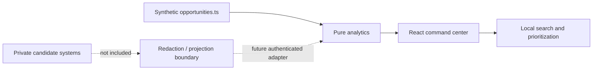

# Architecture

The public build is a zero-backend product slice. Static records make the UI reproducible and auditable, while pure analytics functions keep prioritization logic testable outside React.

